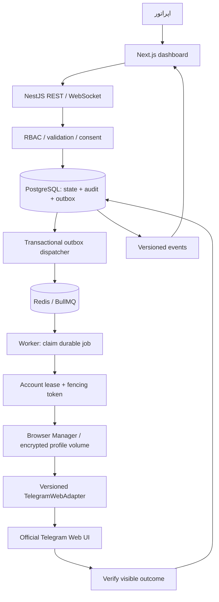

# معماری ربات هوشمند

## دامنه و امکان‌پذیری
به‌روزرسانی فاز دوم: احراز هویت، RBAC، CRUD اکانت، رمزگذاری شماره، نشست پایدار در DB و Audit تراکنشی پیاده‌سازی و با PostgreSQL واقعی تست شده‌اند. health مرورگر، connect و disconnect تا فاز سوم Unsupported هستند. جزئیات API در API.md و نتایج اجرا در docs/verification.md است.
فاز اول زیرساخت قابل اجراست؛ ورود مدیر، اتصال اکانت، ارسال و داشبورد عملیاتی در فازهای بعد ساخته می‌شوند. هیچ نتیجه ساختگی به عنوان عملیات تلگرام نمایش داده نمی‌شود.
تنها مسیر اجرای عملیات Telegram Web رسمی با Playwright Chromium است. API، MTProto، استخراج پنهان داده، ارسال بدون رضایت و دورزدن محدودیت‌ها ممنوع‌اند.
ورود QR/تلفن به اقدام صاحب اکانت نیاز دارد. اطلاعات قابل مشاهده گروه، مجوز مدیریت دعوت و تأیید ارسال تنها پس از بررسی UI قابل تأییدند. قابلیت فاقد کنترل قابل اعتماد در UI باید OPERATION_UNSUPPORTED برگرداند. در این مرحله امکان‌پذیری عملی روی اکانت واقعی تأیید نشده است.

## لایه‌ها و جریان

## تصمیم‌های معماری
- ADR-009 (Phase 2): نشست opaque با هش SHA-256 در PostgreSQL و expiry محدود؛ CSRF HMAC وابسته به نشست، Origin دقیق، کوکی HttpOnly/SameSite و Secure در production. Rate limit اتمی Redis و fail-closed هنگام قطع Redis. کلیدهای مستقل AES-GCM/HMAC از config اجباری؛ شماره فقط برای ADMIN رمزگشایی می‌شود. عملیات Account و Audit در یک تراکنش؛ حذف پروفایل یا عملیات تاریخی تا پیاده‌سازی lifecycle ممنوع است.
- ADR-001: npm workspaces، TypeScript strict و ESM. apps/web، apps/api و apps/worker مستقل از یکدیگرند. packages/shared قراردادها؛ validation ورودی‌ها؛ database مدل و کلاینت؛ queue سیاست اجرای کار؛ automation-core قرارداد چرخه مرورگر؛ telegram-web-adapter قرارداد تعامل UI؛ ui اجزای بصری.
- ADR-002: PostgreSQL منبع حقیقت است. ثبت Job و Outbox در یک تراکنش، سپس انتشار BullMQ. unique idempotency key در DB الزام است؛ jobId صف به‌تنهایی کافی نیست. Dispatcher و اجرای دامنه در فازهای بعدی‌اند.
- ADR-003: هر اکانت یک persistent userDataDir مستقل دارد. persistent contextهای Playwright پروفایل مشترک ندارند و معمولاً پردازش جدا نیاز دارند؛ مرورگر مشترک برای پروفایل پایدار فرض نمی‌شود. سقف فعال و idle eviction بر اساس benchmark تعیین می‌شود.
- ADR-004: lease در PostgreSQL با token افزایشی و heartbeat؛ قطع lease باید پیش از هر عمل تغییردهنده بررسی شود. پس از crash یا انقضای lease، پیش از واگذاری مجدد باید مرگ مرورگر قبلی تأیید شود؛ fencing به‌تنهایی جلوی کلیک مرورگر قدیمی را نمی‌گیرد.
- ADR-005: پیش از UI mutation، recipient به PROCESSING و attemptedAt ثبت می‌شود. crash در این ناحیه UNKNOWN و بازبینی دستی است؛ exactly-once میان DB و UI ممکن نیست. تأیید UI ادعای delivered/read نیست.
- ADR-006: Redis payload فقط شناسه مرجع و trace است. اطلاعات تماس و پیام در صف/لاگ نیست. حذف یا انصراف مخاطب هنگام اجرای هر پیام دوباره بررسی می‌شود.
- ADR-007: مجوز اکانت و قابلیت UI fail-closed است. registry نسخه‌دار، locator قابل مشاهده، timeout محدود و توقف بر ambiguity. Retry فقط خطای زیرساختی پیش از mutation؛ محدودیت یا privacy موجب توقف می‌شود.
- ADR-008: full profile روی volume رمزگذاری‌شده LUKS، runtime دسترسی 0700، backup رمزگذاری‌شده و قفل مالکیت. رمزگذاری صرف storageState همه IndexedDB و فایل‌های Chromium را پوشش نمی‌دهد. راه‌حل phase 1 ذخیره پروفایل فعال نمی‌کند.

## ریسک‌ها
تغییر DOM، تفاوت زبان UI، انقضای نشست، محدودیت اکانت، مصرف RAM هر Chromium، از دست رفتن Redis، crash میان کلیک و commit، محدودیت نمایش اعضای کانال و دسترسی مدیریت. رفتار خطا و recovery در TROUBLESHOOTING.md ثبت شده است. اثبات امکان‌پذیری عملی فاز ۳ فقط با اکانت آزمایشی مجاز انجام می‌شود. ارسال یا ورود واقعی در فاز اول وجود ندارد.

## فازها و معیار پذیرش
| فاز | خروجی و پذیرش |
|---|---|
| 1 | workspace، مدل relational و migration، Compose PostgreSQL/Redis، API health واقعی، worker probe، web foundation؛ build/typecheck/unit و schema validation موفق؛ integration روی سرویس‌های واقعی جدا گزارش شود |
| 2 | auth امن، RBAC و Account CRUD؛ تست مجوز، validation و DB |
| 3 | BrowserManager، lease و encrypted volume، owner-assisted login؛ تست اکانت مجاز، restart، selector failure و crash |
| 4 | داشبورد اکانت و اتصال واقعی؛ E2E افزودن و reconnect |
| 5 | CRUD، import CSV/Excel، consent، tags/list/suppression؛ تست dedup و حذف داده |
| 6 | wizard کمپین، outbox و worker ارسال؛ تست consent مجدد، pause/cancel و UNKNOWN بدون resend |
| 7 | targets و invitations؛ تست permission و unsupported در UI |
| 8 | WebSocket با resync، logs و analytics؛ تست قطع اتصال و redaction |
| 9 | integration/security/recovery/load؛ ظرفیت مستند مبتنی بر benchmark |
| 10 | image production، TLS، backup/restore و rollout؛ smoke و restore موفق |

## اجرای فاز اول
ابتدا قراردادها و مدل داده، سپس appهای health و صفحه معرفی وضعیت توسعه، Docker توسعه، migration اولیه و تست سیاست‌ها. هیچ ماژول بعدی به صورت mock عملیاتی ارائه نمی‌شود. محدودیت زیرساخت محلی صریحاً در TESTING.md گزارش می‌شود.
