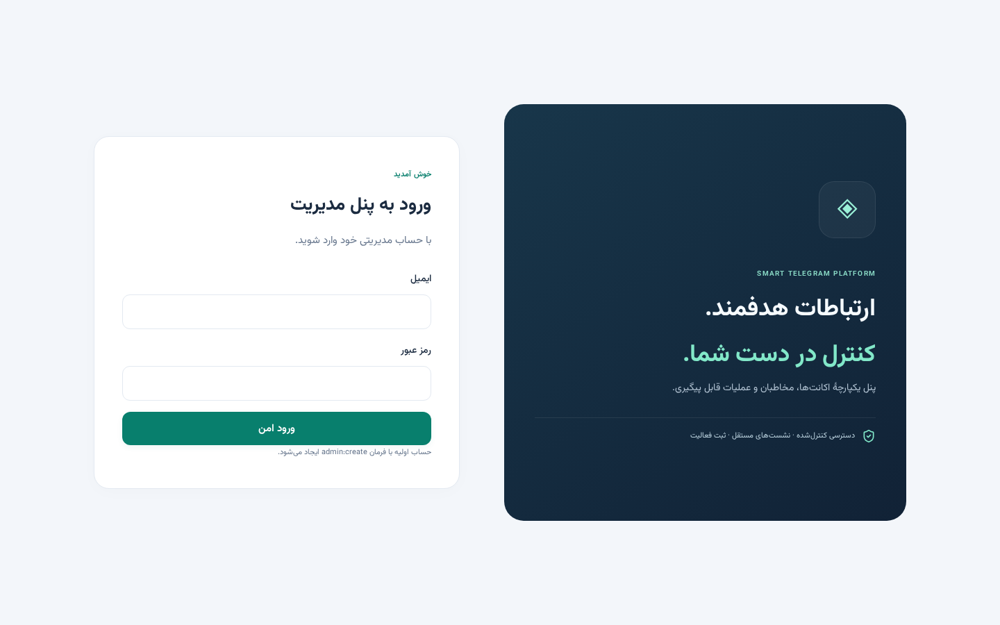
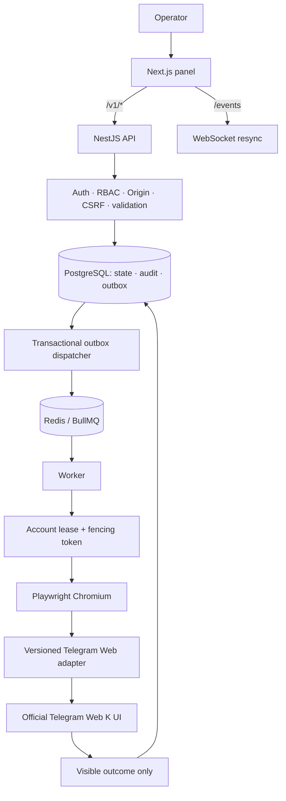

# Smart Telegram Platform

**A self-hosted Telegram Web operations platform for authorized accounts — encrypted profiles, auditable legal authorization, visible-UI automation, and durable background jobs.**

[](LICENSE)
[](https://nodejs.org)
[](https://www.typescriptlang.org)
[](https://nextjs.org)
[](https://www.postgresql.org)
[](https://docs.docker.com/compose/)
[](https://github.com/its-hesam/smart-telegram-platform/actions/workflows/ci.yml)



---

## What this is

Smart Telegram Platform is a **Next.js + NestJS + BullMQ + Playwright** monorepo for
managing Telegram accounts, contacts, lists, campaigns, and member exports from a single
Persian/RTL admin panel.

It drives the **official Telegram Web K UI** in Chromium. It does **not** use the Telegram
Bot API, MTProto, private endpoints, or hidden application state. Every write action is
performed through the visible web UI, and unsupported UI fails closed.

> **Not a Telegram Mini App.** This is a self-hosted web application.

### Core capabilities

| Area | Capability |
|---|---|
| Accounts | Encrypted phone storage, roles, account status, panel-assisted phone/code/2FA login |
| Browser | Persistent Chromium profile, full-profile AES-256-GCM vault, tmpfs runtime, lease + fencing |
| Contacts | CRUD, CSV/XLSX import, tags, lists, merge, suppression, bounded export |
| Sources | Visible group/channel catalog, visible-member extraction, username enrichment, CSV/XLSX |
| Campaigns | Versioned encrypted templates, audience validation, durable outbox, pause/resume/cancel |
| Operations | Durable jobs, progress, checkpoints, retry-safe resume, audit log, analytics |
| Export | Async CSV/XLSX jobs, keyset pagination, streaming CSV, progress, resume |
| Security | Argon2id, opaque sessions, CSRF, exact Origin, AES-GCM fields, RBAC, rate limits |
| Observability | Request IDs, structured logs, Prometheus metrics, OpenTelemetry spans, WebSocket resync |

---

## Architecture



### Stack

- **Web:** Next.js 16, React 19, Tailwind CSS 4, TanStack Query, Radix UI
- **API:** NestJS 12, Zod, Swagger/OpenAPI
- **Worker:** BullMQ 6, Playwright 1.65, Chromium
- **Data:** PostgreSQL 18 + Prisma 7, Redis 8
- **Runtime:** Docker Compose, nginx TLS termination, non-root containers

---

## Safety and legal model

This project is intentionally built around **authorized use**:

- **Visible UI only.** No Bot API, MTProto, private-state reads, or selector guessing.
- **Legal authorization.** Campaign start requires one auditable operator-level
  authorization record with an evidence reference. It replaces per-contact consent forms.
- **Suppression always wins.** A contact marked *do not contact* is excluded even when an
  authorization is active.
- **No silent retries of mutations.** A send that may have reached Telegram is marked
  `UNKNOWN` and requires manual review.
- **Sending is disabled by default.** `TELEGRAM_MUTATIONS_ENABLED=false` until an operator
  installs a verified, account-tested selector registry.
- **Encrypted at rest.** Phones, contacts, templates, invitation links, and full browser
  profiles are encrypted with independent keys.
- **No credentials in logs or queues.** Queue payloads carry job/trace IDs only.

Use this software only with accounts you own or are explicitly authorized to operate, and
only where you have a lawful basis for contacting the people in your lists. You are
responsible for complying with Telegram's Terms of Service and applicable privacy and
anti-spam laws.

---

## Quick start (development)

### Requirements

- Node.js **24.15+ < 25**
- Docker Engine + Compose plugin
- Linux, macOS, or WSL2

### 1. Install

```bash
git clone https://github.com/<your-account>/smart-telegram-platform.git
cd smart-telegram-platform
cp .env.example .env
npm ci
```

Generate three independent 32-byte keys and put them in `.env`:

```bash
openssl rand -hex 32   # DATA_ENCRYPTION_KEY
openssl rand -hex 32   # IDENTITY_HMAC_KEY
openssl rand -hex 32   # PROFILE_ENCRYPTION_KEY
```

### 2. Start infrastructure and migrate

```bash
npm run infra:up
npm run db:migrate
npm run build
```

### 3. Create the first administrator

```bash
ADMIN_EMAIL=admin@example.com \
ADMIN_PASSWORD='use-a-long-unique-password' \
npm run admin:create
```

### 4. Run

```bash
# terminal 1
npm run dev:web

# terminal 2
npm run dev:api

# terminal 3
npm run dev:worker
```

Open `http://localhost:3000`.

For a containerized development stack:

```bash
docker compose up --build -d
```

---

## Configuration

| Variable | Purpose | Default |
|---|---|---|
| `DATABASE_URL` | PostgreSQL connection string | required |
| `REDIS_URL` | Redis connection string | required |
| `APP_ORIGIN` | Exact public origin, e.g. `https://panel.example.com` | required |
| `DATA_ENCRYPTION_KEY` | AES-256-GCM field key (64 hex chars) | required |
| `IDENTITY_HMAC_KEY` | Keyed HMAC for dedup identity | required |
| `PROFILE_ENCRYPTION_KEY` | AES-256-GCM profile vault key | required |
| `SESSION_TTL_SECONDS` | Admin session lifetime | `28800` |
| `TELEGRAM_MUTATIONS_ENABLED` | Enable real Telegram writes | `false` |
| `ACTION_INTERVAL_MS` | Minimum spacing between actions | `30000` |
| `QUEUE_MAX_PENDING` | Queue backpressure threshold | `5000` |
| `EXPORT_ROOT` | Shared export directory | `/tmp/smart-exports` |
| `EXPORT_BATCH_SIZE` | Contacts per export batch | `500` |
| `WORKER_DISPATCH_BATCH` | Outbox events per tick | `500` |
| `WORKER_MAINTENANCE_MS` | Recovery/reconcile interval | `15000` |

Keys must be independent. Never reuse `DATA_ENCRYPTION_KEY` as `IDENTITY_HMAC_KEY` or
`PROFILE_ENCRYPTION_KEY`.

---

## Using the panel

1. **Accounts** — add an account you own or are authorized to manage.
2. **Telegram login** — open the account, start login, and complete phone → code → optional
   2FA in the official Telegram Web UI.
3. **Legal authorization** — in **Settings → Legal outreach authorization**, record your
   evidence reference once. Campaign start is blocked until this exists.
4. **Contacts** — import CSV/XLSX, create lists, mark *do not contact* when needed.
5. **Sources** — refresh the account's visible group/channel catalog, select sources, and
   export visible members.
6. **Campaigns** — build a draft, validate the audience, and start. Progress and results are
   durable and visible under **Jobs**.
7. **Exports** — CSV/XLSX exports run asynchronously with progress and a resume action.

### Export API

```http
POST /v1/contacts/export/jobs        # { "format": "csv" | "xlsx" }
GET  /v1/contacts/export/jobs/:id    # progress, processed, totalItems
GET  /v1/contacts/export/jobs/:id/file
POST /v1/contacts/export/jobs/:id/resume
GET  /v1/contacts/export             # direct streaming CSV
```

### Authorization API

```http
GET    /v1/settings/outreach-authorization
POST   /v1/settings/outreach-authorization   # { "evidenceReference": "contract/2026-11" }
DELETE /v1/settings/outreach-authorization
```

Full API notes: [API.md](API.md) · [docs/OPTIMIZATION.md](docs/OPTIMIZATION.md)

---

## Repository layout

```text
apps/
  web/                          Next.js / React / Tailwind panel
  api/                          NestJS API, auth, contacts, campaigns, operations
  worker/                       BullMQ worker, login bridge, source extraction, exports
packages/
  shared/                       Domain contracts, crypto, consent/authorization, export
  database/                     Prisma schema, migrations, client factory
  automation-core/              Browser manager, encrypted profile vault, lease
  telegram-web-adapter/         Versioned Telegram Web UI selectors and flows
  queue/                        Outbox, durable claims, recovery, failure policy
  validation/                   Zod environment and input contracts
  ui/                           Shared UI boundary
infrastructure/
  docker/                       Production image and seccomp profile
  nginx/                        TLS reverse proxy and streaming locations
  deploy/                       Backup and least-privilege DB role provisioning
tests/
  unit/                         Offline policy, security and export tests
  integration/                  Real PostgreSQL / Redis / BullMQ
  browser/                      Chromium fixtures
  recovery/                     Database restore and account-flow drills
docs/                           Architecture, API, database, security, release notes
```

---

## Testing

```bash
npm run typecheck   # API, worker, packages and web
npm test            # unit tests (no external services)
npm run build       # Prisma generate + TypeScript + Next production build
```

Integration and recovery drills require PostgreSQL, Redis, and a disposable database:

```bash
npm run test:integration
npm run test:restore
```

The recovery drill in `tests/recovery/optimization-drill.ts` exercises the legal
authorization gate, batched campaign start, CSV/XLSX export, and export resume.

---

## Production deployment

1. Copy `.env.example` to `.env` and set production values.
2. Provide TLS certificates and set `TLS_CERT_DIR`.
3. Use a least-privilege PostgreSQL role (see `infrastructure/deploy/provision-db-role.mjs`).
4. Build and start:

```bash
docker compose -f docker-compose.production.yml build api web worker
docker compose -f docker-compose.production.yml run --rm migrate
docker compose -f docker-compose.production.yml up -d
```

5. Verify:

```bash
docker compose -f docker-compose.production.yml ps
curl -fsS http://127.0.0.1:3001/health/ready
```

Operational notes:

- Database backups are encrypted and retained on a schedule; include off-host storage and
  test a full restore before relying on them.
- The worker uses a dedicated `tmpfs` profile runtime and a restricted seccomp profile.
- Keep Redis and PostgreSQL private. Publish only the TLS reverse proxy.
- Sending remains disabled until `TELEGRAM_MUTATIONS_ENABLED=true` **and** a verified
  selector registry is installed.

See [ARCHITECTURE.md](ARCHITECTURE.md), [SECURITY.md](SECURITY.md),
[ACCOUNT_SESSIONS.md](ACCOUNT_SESSIONS.md), and [DEPLOYMENT.md](DEPLOYMENT.md).

---

## Current limitations

This is an actively developed self-hosted project, not a turnkey audited product.

- The default selector registry covers the public Telegram Web login page only.
- Real message sending requires an account-specific, verified selector registry.
- No key-rotation tooling is shipped yet.
- Integration/load testing with multiple Chromium workers is not complete.
- Telegram UI changes can require adapter updates; unsupported UI fails closed.
- Member extraction is limited to what Telegram visibly renders to the signed-in account.
- The panel is Persian/RTL first; other locales are not translated yet.

---

## Contributing

Issues and pull requests are welcome. Please read [CONTRIBUTING.md](CONTRIBUTING.md) and
[SECURITY.md](SECURITY.md) before opening a security-sensitive report.

---

## License

GNU General Public License v3.0. See [LICENSE](LICENSE).

---

## خلاصهٔ فارسی

**پلتفرم تلگرام هوشمند** یک پنل مدیریت خودمیزبان برای اکانت‌های تلگرامِ مجاز است که با
Playwright رابط رسمی Telegram Web را کنترل می‌کند؛ بدون Bot API یا MTProto.

- پروفایل مرورگر رمزگذاری‌شده، ورود پنلی با شماره/کد/رمز دومرحله‌ای
- مدیریت مخاطبان، لیست‌ها، منع ارسال و خروجی CSV/Excel
- استخراج اعضای قابل‌مشاهده و ثبت خودکار مخاطبین
- کمپین‌ها با مجوز قانونی ثبت‌شده و صف پایدار
- خروجی غیرهم‌زمان با پیشرفت و امکان ادامه پس از خطا
- ارسال واقعی به‌صورت پیش‌فرض خاموش است و به Selector تأییدشده نیاز دارد

استفاده فقط با اکانت‌های متعلق به خود یا دارای مجوز صریح، و رعایت قوانین تلگرام و
مقررات حفاظت از داده مجاز است.
